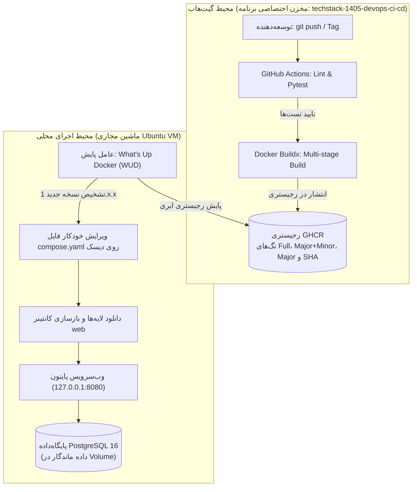

در این تمرین، با ترکیب مهارت‌های کانتینرسازی [هفته‌ی پنجم](../05-week5/10-assignment.md) و مفاهیم پایپ‌لاین این هفته، یک چرخه‌ی کامل و واقعی **End-to-End CI/CD** را پیاده‌سازی می‌کنید:

1. **یکپارچه‌سازی مداوم (CI):** اجرای خودکار تست‌های واحد پایتون و ارزیابی استایل کد با Linter در محیط ابری GitHub Actions بر روی تمام Pull Requestها.
2. **تحویل مداوم (Continuous Delivery):** ساخت خودکار ایمیج بهینه‌شده به روش Multi-stage و انتشار در رجیستری **GHCR** همراه با ترکیب کامل تگ‌های نسخه‌بندی SemVer (تگ کامل، ترکیب Major+Minor و تگ Major) و هش کامیت پس از ادغام با شاخه `main`.
3. **شبیه‌سازی استقرار پیوسته (CD Simulation):** پایش فعال رجیستری توسط ماشین مجازی محلی اوبونتو با استفاده از ابزار **What's Up Docker (WUD)** و به‌روزرسانی خودکار فایل `compose.yaml` و کانتینر برنامه بدون نیاز به باز کردن پورت‌های ورودی اینترنتی یا کلیدهای خطرناک SSH.
4. **تست سلامت و بازگشت (Rollback):** اعتبارسنجی پاسخ سرویس پس از به‌روزرسانی و ثبت سازوکار بازگشت ایمن به نسخه قبل.

پیش از شروع، درس‌های این هفته به‌ویژه [طراحی پایپ‌لاین تست و ارزیابی کد](03-ci-pipeline-lint-test.md)، [خودکارسازی ساخت و انتشار ایمیج داکر](06-container-ci-ghcr.md) و [تحویل و استقرار مداوم و الگوهای انتشار](07-cd-deployment-strategies.md) را مرور کنید.

---

## نمودار معماری چرخه CI/CD



---

## مشخصات فنی و استانداردهای تمرین

پیاده‌سازی شما باید دقیقاً مطابق مشخصات زیر باشد:

| مولفه / نیازمندی | مقدار استاندارد الزامی | توضیحات |
| :--- | :--- | :--- |
| **مخزن برنامه و فایل Workflow** | `app/.github/workflows/ci-cd.yaml` | مخزن مستقل گیت‌هاب برای کدهای برنامه با Workflow تست، بیلد و انتشار ایمیج |
| **فایل استقرار محلی** | `compose.yaml` | فایل مجزا در محیط اجرای محلی (سرور / VM) برای اجرای سرویس‌ها |
| **تست خودکار** | `pytest` و `flake8` با `tests/requirements-test.txt` | اجرای موفق تست‌ها و بررسی نگارش روی تمام PRها و شاخه `main` در مخزن برنامه |
| **تگ‌گذاری ترکیبی ایمیج** | هر ۳ سطح SemVer (`full`, `major+minor`, `major`) + `sha` | تولید خودکار تگ‌های `1.0.1`، `1.0`، `1` و هش کامیت با `docker/metadata-action` |
| **مجوزهای امنیتی اکشن** | `permissions: contents: read, packages: write` | رعایت اصل حداقل دسترسی برای توکن `GITHUB_TOKEN` |
| **رجیستری انتشار** | `ghcr.io/<username>/techstack-1405-devops-ci-cd` | انتشار ایمیج در GHCR با دسترسی عمومی (`Public`) |
| **محیط اجرای محلی** | Ubuntu VM (محیط دوره‌ی آموزشی) | اجرای سرویس‌ها در ماشین لینوکسی بدون نیاز به پورت ورودی اینترنتی |
| **شبیه‌سازی CD محلی** | What's Up Docker (`getwud/wud:9.6.0`) | پایش رجیستری، فیلتر نسخه‌های `1.x.x`، استثنا کردن دیتابیس و ویرایش خودکار فایل Compose |
| **پایگاه‌داده** | `postgres:16-alpine` | سرویس دیتابیس همراه با Named Volume ماندگار |
| **مدیریت محرمانگی** | بدون Secret در گیت‌هاب برای ماشین لوکال | فایل `.env` لوکال روی سرور بماند؛ نیازی به کلید SSH در گیت‌هاب نیست |

---

## گام ۱ — آماده‌سازی ساختار پروژه و ایجاد مخزن برنامه

در این تمرین برای اینکه بتوانید هر دو بخش ساخت (CI) و استقرار (CD) را روی ماشین خود تجربه کنید، ساختار پروژه را به دو بخش تقسیم می‌کنیم:
- **پوشه `app/` (سمت برنامه):** این پوشه مخزن مستقل Git شما در GitHub به نام `techstack-1405-devops-ci-cd` خواهد بود تا پایپ‌لاین CI به ازای تغییرات کد، تست‌ها را اجرا کرده و ایمیج را در GHCR منتشر کند.
- **فایل `compose.yaml` (سمت استقرار):** بیرون از پوشه برنامه و در ریشه محیط کاری قرار می‌گیرد تا کانتینرها را با استفاده از ایمیج منتشرشده در GHCR اجرا کند و توسط WUD مدیریت شود.

{}
توجه داشته باشید که داشتن یک ساب‌فولدر برای برنامه (`app/`) و قرار دادن `compose.yaml` در کنار آن روی یک ماشین واحد، صرفاً یک چیدمان آزمایشگاهی برای این تمرین است و نباید آن را یک Best Practice فرض کنید. در محیط‌های واقعی تجاری، کدهای هر برنامه در مخازن مستقل نگهداری می‌شوند و محیط‌های اجرا و فایل‌های استقرار زیرساخت نیز در بسترها و مخازن کاملاً جداگانه (مانند مخازن اختصاصی GitOps) مدیریت می‌گردند.
{}

ساختار نهایی محیط کار شما به شکل زیر خواهد بود:

```text
week-6-lab/
├── compose.yaml          # فایل استقرار سرویس‌ها روی سرور / ماشین مجازی (گام ۴)
└── app/                  # مخزن Git اختصاصی کدهای برنامه در GitHub
    ├── .github/
    │   └── workflows/
    │       └── ci-cd.yaml # پایپ‌لاین تست و بیلد و انتشار در GHCR (گام ۳)
    ├── .gitignore
    ├── app.py
    ├── requirements.txt
    ├── tests/
    │   ├── requirements-test.txt
    │   └── test_app.py
    └── Dockerfile        # دستورالعمل کانتینرسازی برنامه (گام ۲)
```

### دریافت کدهای آزمایشی برنامه و مقداردهی مخزن Git

1. در حساب GitHub خود یک مخزن جدید به نام `techstack-1405-devops-ci-cd` ایجاد کنید.
2. در ماشین کاری خود دایرکتوری تمرین را بسازید، وارد پوشه `app/` شوید و بسته آماده کدهای آزمایشی را دریافت و استخراج کنید:

```bash
mkdir -p ~/week-6-lab/app
cd ~/week-6-lab/app
wget -O techstack-1405-devops-ci-cd.zip "/bin/week-6/techstack-1405-devops-ci-cd.zip?v=2"
unzip techstack-1405-devops-ci-cd.zip
rm techstack-1405-devops-ci-cd.zip
```

همچنین می‌توانید فایل [techstack-1405-devops-ci-cd.zip](../../../bin/week-6/techstack-1405-devops-ci-cd.zip?v=2) را مستقیماً دریافت کرده و درون پوشه `app/` استخراج نمایید.

پس از استخراج، پوشه `app/` شامل فایل‌های زیر است:
```text
app/
├── .gitignore
├── app.py
├── requirements.txt
└── tests/
    ├── requirements-test.txt
    └── test_app.py
```

اجزای تشکیل‌دهنده این بسته:
- **`.gitignore`:** نادیده گرفتن فایل‌های موقت، کش تست‌ها (`__pycache__` و `.pytest_cache`) و محیط‌های مجازی پایتون.
- **`app.py`:** وب‌سرویس سبک Flask با اندپوینت‌های `/` (نسخه جاری) و `/health` (بررسی پینگ اتصال به PostgreSQL).
- **`requirements.txt`:** بسته‌های رانتایم محصول (`Flask` و `psycopg2-binary`) برای نصب در ایمیج نهایی.
- **`tests/test_app.py`:** آزمون‌های واحد جهت ارزیابی درستی عملکرد اندپوینت‌ها.
- **`tests/requirements-test.txt`:** بسته‌های محیط ارزیابی کد (`pytest` و `flake8`) برای اجرای تست‌ها در پایپ‌لاین CI.

3. پوشه `app/` را به عنوان مخزن Git مقداردهی کرده و به مخزن راه دور گیت‌هاب خود متصل کنید:

```bash
git init
git remote add origin https://github.com/<your-github-username>/techstack-1405-devops-ci-cd.git
```

---

## گام ۲ — ایجاد Dockerfile چندمرحله‌ای (Multi-stage)

فایل `Dockerfile` را درون پوشه `app/` بسازید:

```dockerfile
# Stage 1: Builder
FROM python:3.12-slim AS builder

WORKDIR /build
COPY requirements.txt .
RUN pip install --no-cache-dir --user -r requirements.txt

# Stage 2: Runtime
FROM python:3.12-slim AS runtime

WORKDIR /app

# Pass build-time version argument and persist as runtime environment variable
ARG APP_VERSION=dev
ENV APP_VERSION=${APP_VERSION}

# Copy installed dependencies from builder stage
COPY --from=builder /root/.local /root/.local
ENV PATH=/root/.local/bin:$PATH
ENV PYTHONUNBUFFERED=1

COPY app.py .

EXPOSE 5000

CMD ["python", "app.py"]
```

---

## گام ۳ — ساخت Workflow کامل CI/CD (`.github/workflows/ci-cd.yaml`)

درون پوشه `app/`، مسیر و فایل `.github/workflows/ci-cd.yaml` را ایجاد کنید. این فایل دو وظیفه کلیدی دارد:
1. جاب `test`: نصب نیازمندی‌های تست از `tests/requirements-test.txt`، سپس اجرای Linter و آزمون‌های `pytest` روی تمام PRها و کامیت‌های شاخه اصلی.
2. جاب `build-and-push`: پس از گذر موفق تست‌ها، در صورت ارسال تگ نسخه یا ادغام با شاخه `main`، ایمیج چندمرحله‌ای را با **هر ۳ سطح ترکیب تگ SemVer** (`full`، `major+minor`، `major`) به همراه هش کامیت بیلد کرده و به GHCR می‌فرستد.

```yaml
name: CI/CD Pipeline

on:
  push:
    branches: [ "main" ]
    tags: [ "v*.*.*" ]
  pull_request:
    branches: [ "main" ]

permissions:
  contents: read
  packages: write

jobs:
  test:
    name: Lint & Test
    runs-on: ubuntu-latest
    steps:
      - name: Checkout Code
        uses: actions/checkout@v7

      - name: Set up Python
        uses: actions/setup-python@v7
        with:
          python-version: "3.12"
          cache: "pip"

      - name: Install dependencies
        run: |
          python -m pip install --upgrade pip
          pip install -r tests/requirements-test.txt

      - name: Run Linter (flake8)
        run: flake8 . --count --max-line-length=120 --statistics

      - name: Run Unit Tests (pytest)
        run: pytest -v tests/

  build-and-push:
    name: Build & Push Image
    needs: test
    if: github.event_name == 'push'
    runs-on: ubuntu-latest
    steps:
      - name: Checkout Code
        uses: actions/checkout@v7

      - name: Set up Docker Buildx
        uses: docker/setup-buildx-action@v4

      - name: Log in to GitHub Container Registry
        uses: docker/login-action@v4
        with:
          registry: ghcr.io
          username: ${{ github.repository_owner }}
          password: ${{ secrets.GITHUB_TOKEN }}

      - name: Extract Docker metadata
        id: meta
        uses: docker/metadata-action@v6
        with:
          images: ghcr.io/${{ github.repository }}
          tags: |
            type=sha,format=short,prefix=sha-
            type=raw,value=latest,enable={{is_default_branch}}
            type=semver,pattern={{version}}
            type=semver,pattern={{major}}.{{minor}}
            type=semver,pattern={{major}}

      - name: Build and Push
        uses: docker/build-push-action@v7
        with:
          context: .
          push: true
          tags: ${{ steps.meta.outputs.tags }}
          labels: ${{ steps.meta.outputs.labels }}
          build-args: |
            APP_VERSION=${{ steps.meta.outputs.version }}
          cache-from: type=gha
          cache-to: type=gha,mode=max
```

### ثبت اولیه کدها و انتشار نسخه `v1.0.0`

درون پوشه `app/` تغییرات را به مخزن GitHub بفرستید و نخستین برچسب نسخه را صادر کنید:

```bash
git add .
git commit -m "feat: initial commit with app and ci/cd"
git branch -M main
git push -u origin main

git tag v1.0.0
git push origin v1.0.0
```

{}
پس از اتمام اجرای اکشن بیلد، در پروفایل GitHub خود به تب **Packages** رفته، پکیج `techstack-1405-devops-ci-cd` را باز کنید و در تنظیمات (**Package settings**) سطح دسترسی آن را از Private به **Public** تغییر دهید تا محیط محلی شما بتواند بدون نیاز به لاگین ایمیج را دانلود کند.
{}

{}
در این تمرین به منظور ساده‌سازی فرآیند و لمس مستقیم چرخه‌ی انتشار، تگ‌های گیت (مانند `v1.0.0` و `v1.0.1`) را به صورت دستی با دستور `git tag` ایجاد و Push می‌کنیم.

اما در پروژه‌های صنعتی و تیم‌های حرفه‌ای DevOps، ایجاد دستی تگ با خطر خطای انسانی یا نقض ترتیب نسخه‌ها همراه است. رویکرد بهتر و استانداردتر، **یکپارچه‌سازی مدیریت نسخه درون پایپ‌لاین CI** با استفاده از ابزارهایی مانند **Semantic Release** یا **commitizen** است؛ این ابزارها با تحلیل خودکار پیام کامیت‌ها (بر پایه قرارداد [Conventional Commits](https://www.conventionalcommits.org/) مانند `feat:` یا `fix:`)، نوع تغییر نسخه (Major، Minor یا Patch) را خودکار تشخیص داده، تگ گیت را صادر کرده و فایل Changelog را بدون دخالت دستی کاربر تولید می‌کنند.
{}

---

## گام ۴ — راه‌اندازی محیط محلی با Docker Compose و WUD

وارد ماشین مجازی لینوکسی خود شوید (یا دایرکتوری کار در ماشین لوکال):

```bash
mkdir -p ~/week-6-lab
cd ~/week-6-lab
```

یک فایل `compose.yaml` با ساختار زیر ایجاد کنید (نام کاربری و مخزن خود را در بخش `image` جایگزین کنید). مطابق مستندات رسمی [تریگر Docker Compose در WUD](https://getwud.app/docs/configuration/triggers/docker-compose/)، نحوه عملکرد این پیکربندی به صورت زیر است:
- **محدودسازی استقرار خودکار به نسخه‌های `1.x.x`:** در استاندارد نسخه‌بندی معنایی (**SemVer: `MAJOR.MINOR.PATCH`**)، تغییر عدد **Major** (مثلاً از `1.x.x` به `2.0.0`) نشان‌دهنده‌ی **تغییرات ناسازگار با نسخه قبل (Breaking Changes)** مانند تغییر ساختار دیتابیس یا حذف متغیرهای محیطی است و هرگز نباید بدون بررسی انسانی به‌طور خودکار مستقر شود. در مقابل، نسخه‌های Minor (`1.1.0`) و Patch (`1.0.1`) با نسخه قبلی سازگارند. بنابراین با برچسب `'wud.tag.include=^1\.\d+\.\d+$$'` روی سرویس `web` و متغیر `WUD_TRIGGER_DOCKERCOMPOSE_LOCAL_THRESHOLD=minor` روی WUD، مشخص می‌کنیم که فقط نسخه‌های سری `1.x.x` به‌طور خودکار جایگزین شوند (علامت `$$` برای جلوگیری از جایگزینی متغیر توسط خود Docker Compose است).
- **به‌روزرسانی خودکار فایل `compose.yaml` و بازسازی کانتینر:** اگر فقط کانتینر در حال اجرا آپدیت شود ولی فایل `compose.yaml` روی `1.0.0` باقی بماند، با اجرای مجدد `docker compose down && docker compose up -d` سرویس ناگهان به نسخه قدیمی `1.0.0` برمی‌گردد! برای حل این مشکل، فایل `./compose.yaml:/wud/compose.yaml` را به کانتینر WUD مانت کرده و تریگر `WUD_TRIGGER_DOCKERCOMPOSE_LOCAL_FILE=/wud/compose.yaml` را فعال می‌کنیم. به محض انتشار تگ جدیدتر در سری `1.x.x` در GHCR، خودِ WUD ابتدا یک نسخه پشتیبان (`BACKUP=true`) می‌گیرد، سپس تگ درون فایل `compose.yaml` روی دیسک را به نسخه جدید تغییر می‌دهد، ایمیج جدید را دانلود کرده، کانتینر `web` را بازسازی (Recreate) می‌کند و ایمیج‌های قدیمی را پاکسازی (`PRUNE=true`) می‌نماید.

{}
سوکت `/var/run/docker.sock` در اختیار WUD قرار می‌گیرد تا تریگر مجوز صدور دستور Pull و Recreate را داشته باشد. از آنجا که این سوکت دسترسی در سطح روت به موتور کانتینری می‌دهد و وب‌سرویس آزمایشی نیز نباید در معرض شبکه عمومی قرار گیرد، **پورت‌های برنامه (`8080`) و داشبورد WUD (`3000`) نباید به صورت عمومی روی شبکه باز شوند**؛ بنابراین هر دو پورت را با `127.0.0.1:...` به صورت امن فقط به لوکال‌هاست مقید می‌کنیم. همچنین با برچسب `wud.watch=false`، سرویس دیتابیس و خود کانتینر WUD از چرخه آپدیت خودکار مستثنی شده‌اند.
{}

```yaml
services:
  web:
    image: ghcr.io/<your-github-username>/techstack-1405-devops-ci-cd:1.0.0
    restart: always
    ports:
      - "127.0.0.1:8080:5000" # Localhost only to prevent public network exposure
    environment:
      - DB_HOST=db
      - DB_NAME=devops_db
      - DB_USER=postgres
      - DB_PASSWORD=postgres
    depends_on:
      - db
    labels:
      - "wud.watch=true"
      - 'wud.tag.include=^1\.\d+\.\d+$$' # Only monitor and update compatible 1.x.x versions

  db:
    image: postgres:16-alpine
    restart: always
    environment:
      - POSTGRES_DB=devops_db
      - POSTGRES_USER=postgres
      - POSTGRES_PASSWORD=postgres
    volumes:
      - pgdata:/var/lib/postgresql/data
    labels:
      - "wud.watch=false" # Database service should not be auto-updated

  wud:
    image: getwud/wud:9.6.0
    container_name: wud
    restart: unless-stopped
    ports:
      - "127.0.0.1:3000:3000" # Localhost only to prevent public network exposure
    environment:
      - WUD_AUTH_ADMIN_USER=admin
      - WUD_AUTH_ADMIN_PASSWORD=LabPassword123
      - WUD_WATCHER_LOCAL_CRON=* * * * *
      - WUD_TRIGGER_DOCKERCOMPOSE_LOCAL_FILE=/wud/compose.yaml
      - WUD_TRIGGER_DOCKERCOMPOSE_LOCAL_BACKUP=true
      - WUD_TRIGGER_DOCKERCOMPOSE_LOCAL_PRUNE=true
      - WUD_TRIGGER_DOCKERCOMPOSE_LOCAL_THRESHOLD=minor
    volumes:
      - /var/run/docker.sock:/var/run/docker.sock
      - ./compose.yaml:/wud/compose.yaml
    labels:
      - "wud.watch=false"

volumes:
  pgdata:
```

اجرای اولیه سرویس‌ها:

```bash
docker compose up -d
```

بررسی صحت اجرا و سلامت سرویس:

```bash
curl http://localhost:8080/
curl http://localhost:8080/health
```

{}
پورت‌های وب‌سرویس (`8080`) و داشبورد WUD (`3000`) به دلایل امنیتی فقط روی لوکال‌هاست ماشین مقید شده‌اند (`127.0.0.1:...`). در داخل خود محیط VM می‌توانید مستقیماً با دستورات `curl http://localhost:8080/` و `curl http://localhost:8080/health` صحت کارکرد را بررسی کنید. برای مشاهده وب‌سرویس یا داشبورد WUD از مرورگر سیستم اصلی (Host) خود از یکی از روش‌های زیر برای پورت فورواردینگ استفاده کنید:

1. **SSH Port Forwarding (روش پیشنهادی):** کافی است هنگام اتصال SSH از سیستم میزبان، پورت‌ها را به سیستم خود تونل کنید:
   ```bash
   ssh -L 8080:localhost:8080 -L 3000:localhost:3000 ubuntu@127.0.0.1 -p 2222
   ```
   سپس در مرورگر سیستم میزبان خود `http://localhost:8080` را برای وب‌سرویس و `http://localhost:3000` (با کاربر `admin` و رمز `LabPassword123`) را برای داشبورد WUD باز کنید.
2. **VirtualBox NAT Port Forwarding:** در تنظیمات شبکه ماشین مجازی در VirtualBox (مسیر **Settings -> Network -> Adapter 1 (NAT) -> Advanced -> Port Forwarding**) قوانین پورت فورواردینگ برای پورت‌های `8080` و `3000` با `Host IP: 127.0.0.1` تعریف کنید.

*(توجه: تمامی لاگ‌های پایش و به‌روزرسانی کانتینرها بدون نیاز به داشبورد و مستقیماً با دستور `docker compose logs -f wud` در ترمینال نیز قابل مشاهده است).*
{}

---

## گام ۵ — شبیه‌سازی انتشار و اجرای چرخه‌ی استقرار خودکار

اکنون چرخه‌ی کامل را با یک انتشار نسخه جدید در مخزن برنامه تجربه می‌کنید:

1. وارد پوشه `app/` (مخزن کدهای برنامه) شوید. در کد برنامه (`app.py`) یک تغییر یا بهبود کوچک ایجاد کنید (مثلاً افزودن یک فیلد یا تغییر پیام متنی در خروجی اندپوینت `index`) و روی یک شاخه جدید (مثلاً `feature/improve-api`) کامیت بزنید:
   ```bash
   cd ~/week-6-lab/app
   git checkout -b feature/improve-api
   git commit -am "feat: improve index response message"
   git push origin feature/improve-api
   ```
2. در گیت‌هاب یک Pull Request باز کنید و ببینید که جاب `test` به طور خودکار اجرا شده و تست‌ها را تایید می‌کند.
3. درخواست را با شاخه اصلی `main` ادغام (Merge) کنید، سپس روی شاخه اصلی کامیت جدید را pull کرده و یک تگ گیت معتبر با نسخه جدید ایجاد و Push کنید:
   ```bash
   git checkout main
   git pull origin main
   git tag v1.0.1
   git push origin v1.0.1
   ```
4. پایپ‌لاین گیت‌هاب اکشنز در مخزن `techstack-1405-devops-ci-cd` به طور خودکار جاب `build-and-push` را اجرا کرده، نسخه `1.0.1` را از تگ گیت دریافت می‌کند و هر ۳ ترکیب تگ SemVer (`1.0.1`، `1.0` و `1`) را در GHCR منتشر می‌سازد.
5. به دایرکتوری ریشه پروژه (`~/week-6-lab`) برگردید و دستور `docker compose logs -f wud` را اجرا کنید تا لاگ‌های WUD را به صورت زنده مشاهده نمایید (با تنظیم `WUD_WATCHER_LOCAL_CRON=* * * * *`، ابزار WUD هر یک دقیقه رجیستری را پایش می‌کند).
6. به محض اینکه WUD تگ جدید `1.0.1` را در GHCR تشخیص دهد، تریگر `dockercompose.local` به طور **کاملاً خودکار**:
   - فایل `compose.yaml` روی دیسک را ویرایش کرده و تگ سرویس `web` را از `:1.0.0` به `:1.0.1` تغییر می‌دهد،
   - ایمیج جدید `ghcr.io/<your-github-username>/techstack-1405-devops-ci-cd:1.0.1` را Pull می‌کند،
   - کانتینر `web` را با ایمیج `:1.0.1` بازسازی (Recreate) می‌کند و ایمیج قدیمی را Prune می‌نماید.
7. محتوای فایل `cat compose.yaml` و خروجی `curl http://localhost:8080/` را بررسی کنید و مطمئن شوید که هم فایل `compose.yaml` و هم کانتینر در حال اجرا بدون دخالت دستی شما به نسخه `1.0.1` ارتقا یافته‌اند و اتصال به دیتابیس بدون از دست رفتن داده برقرار مانده است.

---

## گام ۶ — آزمون بازگشت اضطراری (Rollback)

یکی از مهم‌ترین وظایف مهندس DevOps، تضمین امکان بازگشت سریع در صورت بروز مشکل در نسخه جدید است. در این گام فرض کنید نسخه `1.0.1` دارای باگ ناشناخته‌ای بوده و باید فوراً سیستم را به نسخه امن قبلی (`1.0.0`) بازگردانید:

{}
در محیط‌های واقعی و عملیاتی تجاری (Production)، یک مهندس DevOps **معمولا نباید با SSH وارد سرور شود و تگ فایل‌های تنظیمات را دستی تغییر دهد**! ورود دستی به سرور و تغییر مستقیم فایل‌ها یک ضدالگو (Anti-Pattern) خطرناک است که موجب خطای انسانی، ناهماهنگی در تنظیمات (Configuration Drift) و از بین رفتن امکان ردیابی در Git می‌شود.

مراحلی که در ادامه انجام می‌دهید **صرفاً یک تمرین آموزشی برای لمس مکانیزم بازگشت و درک نحوه عملکرد داکر در محیط آزمایشگاهی محلی** است. در سازمان‌های حرفه‌ای، بازگشت به نسخه قبل (Rollback) نیز مشابه انتشار اصلی، کاملاً خودکار و از طریق پایپ‌لاین CI/CD یا الگوهای GitOps (مثلاً زدن یک کامیت `git revert` در مخزن پیکربندی یا Re-deploy از طریق کنسول استقرار بدون دست زدن به سرور) پیاده‌سازی می‌شود.
{}

1. در فایل `compose.yaml` محلی، تگ ایمیج سرویس `web` را از `1.0.1` به نسخه سالم قبلی (`1.0.0`) برگردانید و برای جلوگیری از اینکه WUD بلافاصله پس از Rollback دوباره آن را به `1.0.1` ارتقا دهد، موقتاً برچسب `wud.watch=false` را تنظیم کنید:
   ```yaml
   services:
     web:
       image: ghcr.io/<your-github-username>/techstack-1405-devops-ci-cd:1.0.0
       # ...
       labels:
         - "wud.watch=false"
   ```
2. با اجرای دستور زیر، کانتینر را بر اساس فایل `compose.yaml` به نسخه `1.0.0` برگردانید:
   ```bash
   docker compose up -d web
   ```
3. با اجرای `curl http://localhost:8080/` صحت بازگشت به نسخه `1.0.0` را اثبات نمایید.

{}
تریگر Docker Compose در WUD از قابلیت بازگشت خودکار در صورت شکست بررسی سلامت (`WUD_TRIGGER_DOCKERCOMPOSE_LOCAL_ROLLBACK=true`) نیز پشتیبانی می‌کند. اگر سرویس دارای `HEALTHCHECK` باشد و نسخه جدید پس از استقرار وضعیت `unhealthy` بگیرد یا کرش کند، WUD به طور خودکار کانتینر معیوب را حذف، کانتینر نسخه قبلی را بازیابی و حتی فایل `compose.yaml` را از روی نسخه پشتیبان (`.back`) به حالت قبل برمی‌گرداند!
{}

{}
با استفاده از تریگر `dockercompose` در WUD، فایل `compose.yaml` روی دیسک سرور همراه با کانتینر به‌روزرسانی شد تا با اجرای `docker compose down && docker compose up -d` نسخه به عقب برنگردد. با این حال، این رویکرد در محیط‌های عملیاتی بزرگ‌تر و تیمی همچنان محدودیت‌هایی دارد:
- **انحراف بین سرور و مخزن Git (Git Drift):** فایل `compose.yaml` روی دیسک ماشین مجازی شما به `1.0.1` تغییر کرده، اما فایل `compose.yaml` داخل **مخزن Git** همچنان روی `1.0.0` است! اگر از مخزن Git روی سرور `git pull` بگیرید یا سرور جدیدی از روی Git بسازید، ناهماهنگی ایجاد می‌شود.
- **نبود تاریخچه ممیزی (Audit Trail) در Git:** از آنجا که تغییر فایل `compose.yaml` مستقیماً روی سرور و خارج از Git انجام شده، در `git log` مشخص نیست چه زمانی و کدام نسخه مستقر شده است.
- **محدود بودن به تغییر تگ ایمیج:** اگر نسخه جدید به متغیر محیطی جدید یا تغییر در ساختار `compose.yaml` نیاز داشته باشد، WUD از آن بی‌اطلاع است.

در محیط‌های صنعتی مدرن (به‌ویژه در Kubernetes با ابزارهایی مانند **Argo CD** و **Flux**)، برای حل این چالش از رویکرد **GitOps** استفاده می‌شود. در GitOps، **مخزن Git تنها منبع حقیقت (Single Source of Truth)** است: هیچ ابزاری فایل‌های روی سرور را خارج از Git ویرایش نمی‌کند؛ بلکه ابتدا تگ نسخه جدید (`1.0.1`) از طریق یک کامیت یا Pull Request خودکار در فایل‌های پیکربندی درون Git ثبت می‌شود و سپس ابزار GitOps محیط اجرا را دقیقاً با مخزن Git همگام‌سازی می‌کند. مبحث GitOps **خارج از محدوده این دوره** است، اما در صورت علاقه می‌توانید درباره آن بیشتر مطالعه کنید.
{}

---

## راهنمای تحویل و ثبت در GitHub

برای تحویل تمرین این هفته:

1. در مخزن دوره‌ی خود یک شاخه‌ی جدید به نام `week-6` بسازید.
2. درون پوشه‌ی اختصاصی خود، دایرکتوری `week-6` را با ساختار تفکیک‌شده‌ی زیر آماده و ثبت کنید:
   - فایل استقرار `compose.yaml`
   - پوشه `app/` شامل کدهای برنامه، تست‌ها، `Dockerfile` و Workflow پایپ‌لاین `.github/workflows/ci-cd.yaml`
   - فایل گزارش مستندات `README.md` شامل:
     - پیوند مخزن گیت‌هاب وب‌سرویس (`https://github.com/<your-username>/techstack-1405-devops-ci-cd`) و تصویر اجرای موفق پایپ‌لاین در تب Actions
     - اسکرین‌شات از داشبورد WUD یا خروجی لاگ‌های WUD (دستور `docker compose logs wud`) در زمان تشخیص خودکار ایمیج جدید در GHCR و ویرایش خودکار `compose.yaml`
     - خروجی تست‌های `curl` قبل از آپدیت، بعد از آپدیت خودکار به `1.0.1`، و بعد از اجرای Rollback
3. تغییرات را Commit و به GitHub بفرستید و یک **Pull Request** با عنوان `Week 6 Assignment - [Your Name]` باز کنید.
